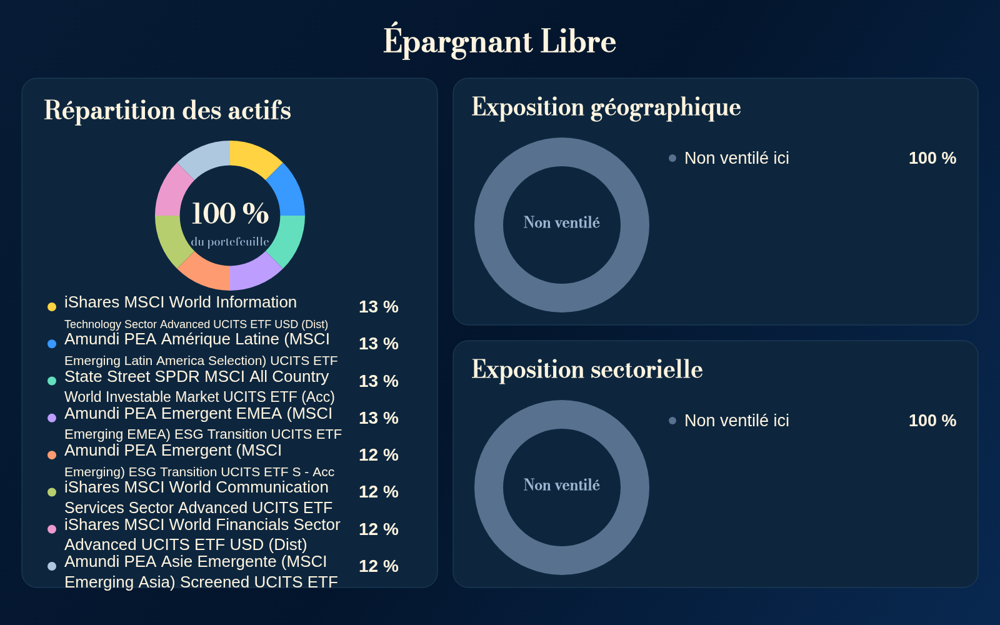
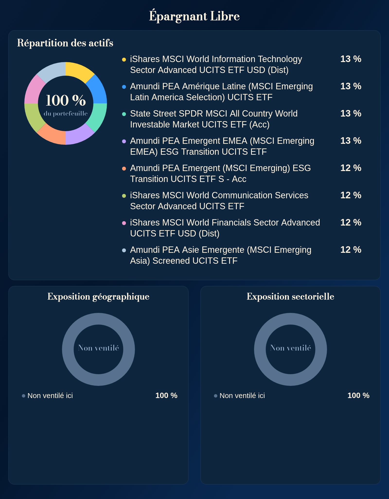
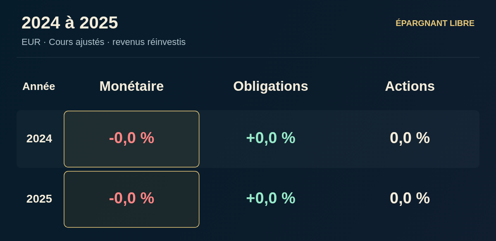
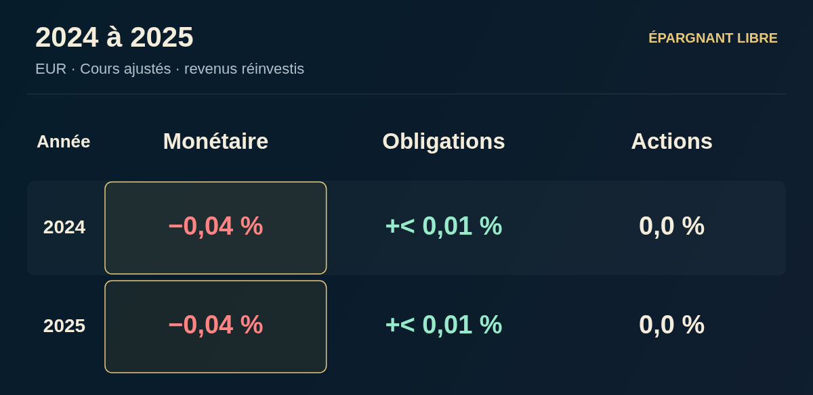

# Recette visuelle des exports — 2 novembre 2026

Base : `master` **414bd67a1afa1ae9cc003e5e98a3f0c0f6b92d2d**. Lecture de `CLAUDE.md`, de la référence du 18 octobre, du registre et du calendrier du 1er novembre. PR ouvertes relues avant modification : #1140 (Budget), #1141 (revue des données), #1061 (encours), #1042 (guide). Nouveau relevé avant livraison : #1142 (preuves automatisations), #1143 (cohérence financière), #1144 (éditorial). Aucun de ces correctifs dupliqué. Le manifeste navigateur conserve ses contrôles existants et ajoute la régression visuelle près du contrôle DCA pour limiter les conflits d’ajouts concurrents.

Les [dernières modifications de chaque moteur](render-history.json) sont relevées avec SHA, titre et date. Références graphiques conservées : classements actuel/annuel (#770/#842), DCA trois donuts (#1011/#1110), budget modèle 3 détaillé/synthétique (#1115), Générateur métallique (#1139), ETF porcelaine bleue, comparatifs papier, Coulisses magazine et composition séparée, investisseurs verre, duels papier, France crème/vert et styles historiques proposés. Les mentions retirées du Générateur **« EUR · rééquilibrage annuel » et « Pas un conseil. » restent absentes**. Aucun pied de source ou avertissement supprimé réintroduit.

## Méthode et portée

Chromium réel, builds Vite, boutons de téléchargement réels, PNG décodés à leur taille native et représentés à 320 px de large. Parcours à **390 et 320 px**, contextes neufs, comparaison de pixels entre les images téléchargées et les aperçus. Le premier passage exerce le bouton de téléchargement de l’aperçu commun ; le second exerce l’action principale de l’outil. Les tests spécialisés complètent ces parcours avec mesures de texte (bornes et collisions), contrôles des nombres, des identités, de l’ordre et des rendus asynchrones. Les images de synthèse servent exclusivement aux tests, dans des contextes jetables ; aucune bibliothèque de portefeuilles ni donnée de production n’est alimentée.

Les planches [1](proofs/contact-0.png), [2](proofs/contact-1.png), [3](proofs/contact-2.png), [4](proofs/contact-3.png), [5](proofs/contact-4.png), [6](proofs/contact-5.png) montrent les PNG du premier passage à **320 px par image**, et non des captures de l’interface. Les fichiers de mesures différencient les rendus automatiquement contrôlés et les parcours réellement téléchargés ; un contrôle géométrique ne signifie pas que chaque combinaison a été relue manuellement.

## Tableau de recette

Les premiers outils ci-dessous appartiennent au calendrier courant ; les autres exports viennent ensuite. « Conforme » porte sur les cas indiqués, pas sur toutes les combinaisons possibles.

| Outil / famille | Cas inspectés et contrôles | Défaut constaté | Correction | Résultat local |
|---|---|---|---|---|
| Performance depuis | Simple/comparatif ; 1–10 années et historique long ; EUR/USD ; pertes et petites variations ; 759 actifs par tests existants | Aucun défaut supplémentaire démontré | Aucune | PNG mobile, période, devise et nombres conformes |
| Qui a vraiment gagné ? | 2–6 actifs, 1–10 années actuel, 2–7 annuel ; noms longs ; pertes, zéro et ±0,004/0,04 % en fixture | −0,04 % affiché −0,0 % ; +0,004 % affiché +0,0 % | Précision adaptative pour les deux présentations ; rangs non modifiés | Cas proches de zéro distingués du zéro exact ; 50 dispositions existantes passent |
| Coulisses des indices | Fiche principale, composition top 10 séparée, indisponibilité, changement rapide, devises/conventions via contrôles existants | Aucun défaut supplémentaire démontré | Aucune | PNG principal et composition comparés aux aperçus ; refus d’export conservé si composition non qualifiée |
| Générateur | 846 rendus : profils, allocations courtes/denses, longs noms, rendements positifs/négatifs/nuls/absents ; actualisation, fond absent/réessai | Aucun défaut supplémentaire démontré | Aucune | Dernier pied supprimé conservé ; vrais téléchargements mobiles conformes |
| Portefeuille & DCA | 636 rendus : 1/2/4/8 positions, 50 en expositions, pays/secteurs/deux/trois donuts ; versements nuls/grands ; identité facultative absente ; longs noms réels et fixtures ; top entreprises | Huit noms longs compressés, dernier libellé hors de sa carte | Carte d’allocation élargie, retours mesurés à 36 px fixes, hauteur calculée ; expositions dessous avec légendes sur une colonne à 30 px, seulement pour le cas dense | Noms et poids complets ; ordre/couleurs conservés ; 636 rendus et régression ciblée sans rognage ni collision |
| Le budget de… | 54 profils × 1440/390/320 px, détaillé/synthétique ; noms longs, déficit, faibles/grands montants, champs facultatifs absents, limites de lignes via recette existante | Aucun défaut visuel nouveau démontré | Aucune ; modèle 3 conservé, #1140 préservée | 162 couples profil/viewport validés, deux versions fidèles aux aperçus ; fixtures de limite et stockage passent |
| Et si tu avais investi ? | 759 actifs × unique/DCA, prix saisi, pertes, fortes valeurs, simple et comparatif ; vrais téléchargements Android simulé | Aucun défaut graphique nouveau démontré | Aucune | Chiffres, unités, courbes et PNG conformes aux résultats du moteur courant ; #1143 reste distincte |
| Comparatif courtiers | Duel de logos, noms longs ; deux parcours mobiles | Aucun défaut démontré | Aucune | PNG 1600×900 conforme ; il ne contient volontairement pas le tableau tarifaire |
| Présentation d’ETF | 279 rendus, titres longs, part récente sans année complète, encours/frais, caractéristiques partielles, signe des performances, fond manquant/réessai | Aucun défaut supplémentaire démontré | Aucune | Parité de pixels confirmée après attente de la régénération asynchrone ; rendu porcelaine préservé |
| Comparatif ETF | 156 thèmes ; 2/3 supports autorisés, longues dénominations, matières premières, pays/secteurs partiels ou absents | Aucun défaut supplémentaire démontré | Aucune | Identités et chiffres conservés ; pas de performances inventées |
| Portefeuilles d’investisseurs | 28 portraits/photographies ; longs noms de positions, autres positions, crédits ; huit allocations modèles × 390/320 px, 12 poches Israelsen comprises | Aucun défaut supplémentaire démontré | Aucune | Dates, poids, portraits et téléchargement/reprise conformes dans les cas exécutés |
| Fiches pratiques | 74 fiches, 1/2/3 colonnes, longs textes et nombres, sources absentes du pied | Aucun défaut supplémentaire démontré | Aucune | Pas de collision ni rognage ; export mobile et scénario existants passent |
| Il y a X ans | 736 rendus ; simple/comparatif, longs niveaux/unités, logos officiels et repli, données facultatives | Aucun défaut supplémentaire démontré | Aucune | Identités, dates, unités et rapports conservés ; 234 aperçus et 468 vrais téléchargements sur le build passent |
| Présentations AV/SCPI/acteurs | Contrats et offres existants ; minima, valeurs qualitatives, longs libellés et conditions ; trois familles graphiques | Aucun défaut supplémentaire démontré | Aucune | Bornes, conditions et parité aperçu/PNG conformes ; variantes SCPI et acteur téléchargées aux deux largeurs |
| France en 100 | 29 cartes courantes ; taux/parts/seuils/comparaisons ; neuf designs accessibles ; parcours et téléchargements des styles historiques ([planches](proofs/france-designs-0.png)) | Aucun défaut supplémentaire démontré sur les échantillons | Aucune | Population et valeur exactes ; style courant et compatibilité conservés |
| Fiche lexique | 44 notions : titres, métaphores et accents via contrôle commun des 910 rendus ; parcours 390/320 | Aucun défaut démontré sur les cas inspectés | Aucune | PNG fidèle ; pas de calcul ni de donnée financière à simuler |
| Pouvoir d’achat | 321 PNG ; montants faibles/grands, dates, compensation/érosion, comparaison, actualisation | Aucun défaut supplémentaire démontré | Aucune | Nombres et dates conservés, absence de coupure/chevauchement ; vrais téléchargements |
| Duel de portefeuilles | 55 duels, 662 supports ; 1–6 actifs par côté, pertes/égalité/grands capitaux | Aucun défaut supplémentaire démontré | Aucune | Poids, capital, années et performance cohérents ; export/réessai passent |
| Banque de tweets, images archivées | Deux illustrations existantes (8 ETF / 20 ETF), noms/ISIN/frais, sans moteur génératif, vrais boutons 390/320 | Aucun défaut graphique démontré | Aucune création d’export | Quatre PNG téléchargés égaux aux images affichées |

## Corrections : preuves avant-après

### DCA / allocation complète dense

Même fixture de huit supports réels aux dénominations les plus longues du catalogue ; poids synthétiques égaux (12,5 %), aucun portefeuille réel enregistré. Avant : fin du dernier nom au-delà du bord inférieur de la carte, seconde ligne de certains noms réduite. Après : noms complets à 36 px, retours mesurés, carte et canvas grandis. L’arrondi de répartition reste celui existant ; les quatre 13 % et quatre 12 % représentent les huit 12,5 % sans changer les poids ni la géométrie des donuts.

| Avant | Après |
|---|---|
|  |  |

### Classements : petits rendements

Fixture graphique indépendante : −0,04 %, +0,004 %, zéro exact. Les valeurs ne sont jamais écrites dans un registre de marché. La correction concerne le formatage dans l’image, sans toucher le moteur financier ni les squelettes de publication. La copie utilise son formatage existant ; la précision d’affichage peut différer sans changer le nombre sous-jacent.

| Avant | Après |
|---|---|
|  |  |

## Exclusions, limites et incidents séparés

- Outils supprimés ou masqués **non réactivés et hors recette** : Impact des frais, Simulateur de patrimoine, Dilemme, Scanner, Vrai/Faux, ancien Comparateur d’indices autonome, Analyse d’entreprise absente du registre courant. Les anciennes fonctions internes ne constituent pas de nouveaux exports accessibles.
- Idées, Hey @Grok, Radar, Histoires de marchés, maintenance et bibliothèque de données n’offrent pas d’image dans le parcours actuel ; leurs exports texte/JSON sont hors périmètre PNG. Vidéos également hors périmètre de cette recette d’images.
- Aucune famille de PNG actuellement accessible n’est laissée entièrement sans parcours de téléchargement. Aucun blocage de téléchargement non résolu n’est constaté dans les parcours qualifiés. Les refus attendus (composition non qualifiée, donnée absente, fichier de fond non chargé) restent protégés ; ils ne sont pas remplacés par un PNG inventé.
- Limite mesurée : le budget à 72 lignes atteint **1200 × 15 807 px** en détaillé. Contenu et décodage ont été contrôlés, mais cet extrême très vertical n’est pas certifié dans le fil X. Le format synthétique existant reste disponible ; aucune pagination ni nouveau type d’export ajouté.
- Pas de certification de chaque croisement possible de sujets, dates, devises, modèles et designs. Les contrôles couvrent les familles et les bornes citées. Aucun téléphone physique, application X, compression après publication sur X ou partage OS n’a été contrôlé ; 320/390 px sont des viewports navigateur et les planches montrent les fichiers à largeur de téléphone.
- Les modèles budgétaires nouveaux et le suivi daté de #1140, les corrections financières de #1143 et les textes de #1144 sont des chantiers distincts tant qu’ils ne sont pas intégrés au master. Ils ne sont pas annoncés vérifiés dans cette recette initiale.
- Le premier essai du script historique `playwright-index-concentration.mjs` en serveur de développement a échoué sur un import dynamique de module. Le même parcours sur le build publié localement réussit (paramètre `INDEX_TEST_BASE_URL`), avec vrais téléchargements et parité. Ce défaut d’outillage ne constitue pas un défaut de PNG.

## Validation et publication

`npm run build` : compilation, budgets inchangés, couverture des champs et concordance des 42 fichiers du manifeste validés localement. Les logs et reçus accompagnent ce dossier. 22 cas ciblés supplémentaires vérifient les noms, les collisions, les arrondis et les limites de 3/4/6 catégories, avec et sans top entreprises ; les chemins DCA denses réels téléchargent le fichier exact de l’aperçu aux deux largeurs. Nouveau contrôle CI : `test-image-density.mjs && playwright-image-density.mjs` ; contrôles existants préservés. Le test DCA mesure désormais les limites du canvas réel, nécessaire pour un export à hauteur adaptative, sans relâcher les assertions de collision ou d’exhaustivité.

**Statuts au dépôt initial de la PR :** tests locaux réalisés, CI à attendre, non fusionné, non vérifié en production pour ces corrections. Les références CI, fusion, Pages et `build-info.json` seront renseignées après leur résultat effectif dans la description de PR et les reçus de livraison. Aucun succès de publication n’est déduit d’un build local.

## Reproduire la recette

```sh
npm ci
npm run build
node scripts/test-image-density.mjs
node scripts/playwright-image-density.mjs
# Dans un autre terminal : npm run preview -- --host 127.0.0.1 --port 4173
node scripts/audit-image-downloads.mjs
node scripts/audit-secondary-image-downloads.mjs
```

`CHROMIUM_PATH` sélectionne un exécutable installé ; sans cette variable, les scripts utilisent Chromium fourni par Playwright. `IMAGE_AUDIT_BASE` et `IMAGE_AUDIT_OUT` permettent de qualifier le site public après publication. Les captures de données de test restent dans des contextes navigateur jetables. Le contrôle commun de 910 rendus contient également un moteur interne de comparateur : il n’est pas compté comme outil accessible et n’a pas été réintroduit.

Les comparaisons PNG prennent une photographie de l’image **avant** le clic : certaines actions redessinent l’aperçu pendant le téléchargement. Examiner seulement le DOM immédiatement après ce clic donnait un aperçu temporairement absent dans l’instrumentation, sans différence de fichier. Les reprises ETF et anniversaire confirment la parité ; la recette finale utilise cette capture préalable.

## Complément sur le master intégré

Master `3719173` intégré en `b81f340` : #1140 et la photographie S&P validée sont conservés sans divergence dans les fichiers Budget ou données partagées. Les sept nouveaux profils ont été contrôlés en détaillé/synthétique à 390 et 320 px (14 couples profil/viewport), en plus des 162 couples de la banque initiale ; les PNG détaillés ont été inspectés à largeur de téléphone. Compilation intégrée et parcours DCA rejoués. Le parcours à 50 positions couvre aussi les cinq variantes avec six catégories et top entreprises : dix vrais téléchargements aux deux largeurs, tous égaux aux aperçus.

Le dernier contrôle visuel du cas dense a conduit à garder ses légendes de donuts sur **une seule colonne, à 30 px** (pourcentages à 32 px), plutôt que la petite légende à deux colonnes de la variante « deux donuts ». Les 636 rendus DCA et 22 cas ciblés repassent ; les autres variantes gardent leur maquette.

Écart textuel hors périmètre image : `formatPercent(0.004)` et `formatPercent(-0.004)` dans `src/pages/performance-rankings/engine.js` donnent encore `+0,0 %` et `-0,0 %` dans la copie. Reproduction sans stockage : importer `formatPercent` dans Node et appeler ces deux valeurs. Le formatage des images est corrigé ; le squelette et le formatage de la copie restent au chantier éditorial, sans présumer que #1144 traite déjà ce cas.
