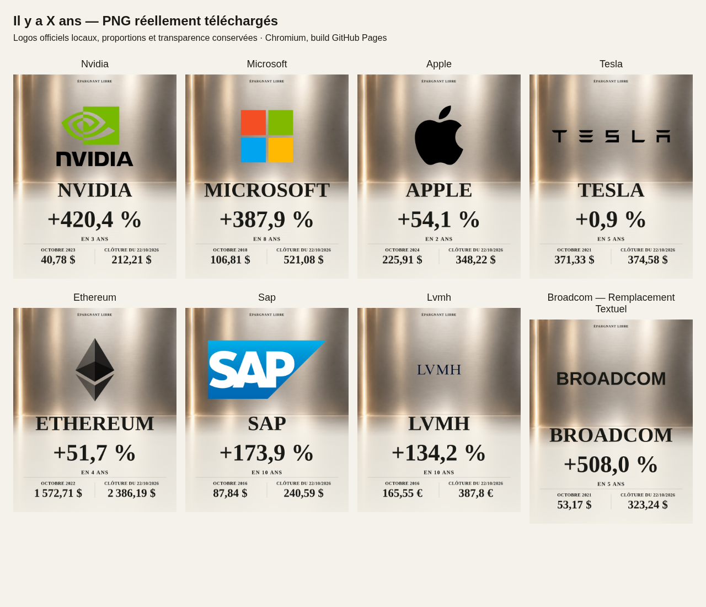

# Logos « Il y a X ans » — vérification du 24 octobre 2026

L’aperçu et les deux téléchargements PNG utilisent les mêmes fichiers officiels
locaux, sans métal, relief, recoloration, étirement ou fond ajouté. La pomme
incorporée au fond généré est remplacée par le véritable SVG Apple sur le fond
vierge existant. Le moteur attend les images ; un fichier absent ou illisible
produit un remplacement textuel et peut être retenté au téléchargement suivant.
Les données, calculs, textes financiers et réglages sont conservés.

18 logos intégrés : Nvidia, Microsoft, Apple, ASML (fichier officiel existant
réutilisé), Tesla, Bitcoin, Ethereum, SAP, LVMH, Meta, Air Liquide, Coca-Cola Company,
Visa, Procter & Gamble, Johnson & Johnson, JPMorgan Chase, UnitedHealth et PayPal.
[Sources officielles et variantes](../../public/asset-art/official-logos/sources.json).
Les variantes blanches peu lisibles ont été écartées ; LVMH utilise son PNG sombre
officiel à sa résolution native.

## Actifs sans fichier validé

La couverture n’est pas exhaustive : sur 689 actifs admissibles, 18 ont un logo,
669 conservent une identité textuelle et l’or/l’argent gardent leurs illustrations.
La [liste complète](coverage.csv) signale chaque actif, notamment Broadcom, Amazon,
Alphabet, Nestlé, Netflix, Nike, Disney, Berkshire Hathaway et les indices/fonds.
Cela signifie « aucun fichier officiel exploitable vérifié dans cette correction »,
pas « l’entreprise n’a pas de logo ». Aucun logo d’émetteur n’est attribué à un
indice ou un fonds. Les petites images opaques de Broadcom/Disney et les variantes
blanches Home Depot/ExxonMobil ont été écartées plutôt que retouchées ou inventées.

## Vérifications

| Contrôle | Résultat |
| --- | --- |
| `npm run build` | Réussi, prébuild et audits de bundles/couverture compris |
| Oxlint sur les cinq fichiers JS modifiés/ajoutés | Réussi |
| `test-browser-shards.mjs` | Réussi ; nouveau test intégré à la CI navigateur existante |
| `test-anniversary-art.mjs` | 709 exports : 689 actifs et 20 comparatifs ; chiffres, unités, labels, dimensions, textes longs, repli et reprise |
| `test-anniversary-logos.mjs` sur le build de production | 38 aperçus, 76 vrais téléchargements via les deux boutons ; pixels identiques à l’aperçu |
| Chromium 1440 × 1000 et émulation iPhone 13 | Les 18 logos et Broadcom sans logo, proportions, marges, centrage, transparence et changement d’actif vérifiés |
| Chargement retardé, changement pendant ce chargement | Pas d’export prématuré ; une ancienne réponse ne remplace pas le nouvel actif |
| Logo absent / SVG corrompu | Aperçu et PNG textuels sans image cassée ; le logo revient après reprise |
| `test-shared-history-art.mjs`, `test-anniversary-editorial.mjs`, `test-anniversary-indices.mjs` | Réussis |

[Résultats détaillés et empreintes des pixels](browser-results.json).
Les 18 PNG et leurs variantes mobiles ont aussi été examinés visuellement.
Les tests n’utilisent aucun service de logos externe. Tous les chemins passent par
`/shinny-potato/asset-art/` sur le build destiné à GitHub Pages. Il n’y a eu aucun
déploiement : la vérification des nouveaux fichiers sur le domaine public devra
suivre un futur déploiement autorisé. L’émulation mobile utilise Chromium, pas un
iPhone physique ni Safari.

## Exemples visuels

La planche ci-dessous rassemble des PNG réellement téléchargés, sans retouche des
logos ni des informations. Les périodes peuvent varier car l’outil conserve son
tirage de période existant.

PNG originaux téléchargés : [Nvidia](examples/nvidia.png),
[Microsoft](examples/microsoft.png), [Apple](examples/apple.png).

Aperçus dans l’interface : [ordinateur](examples/desktop-preview.png),
[mobile](examples/mobile-preview.png). Le mobile permet de faire défiler le visuel ;
les PNG téléchargés conservent les 1600 × 2000 pixels complets.
