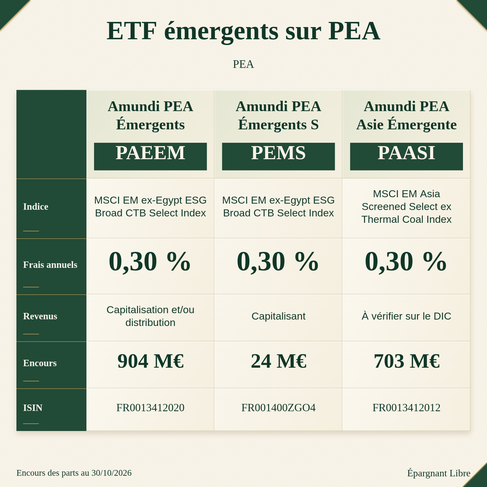
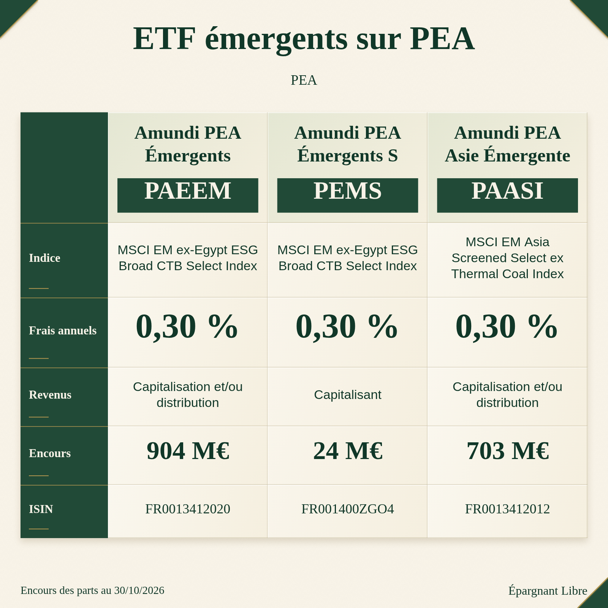

# Qualification financière des réserves — 2 novembre 2026

Travail ciblé après #1143 (calculs), #1144 (éditorial) et #1145 (images). Base initiale `462de7082861280b1d362d23612dad4beb475ca2`, puis master `4b5ea567e0209d958a57f0e67a6109f917c35e1e` intégré : réparation Nikkei #1148 conservée. Les trois fusions sont des ancêtres de cette base. `CLAUDE.md`, référence du 18 octobre et rapports des trois PR relus. PR #1148, #1061 (bloquée, ne pas fusionner) et #1042 relues ; aucun de leurs correctifs dupliqué.

## Résultat et périmètre

Deux causes de lecture d’une politique de revenus sont réparées dans **Fiches pratiques / Émergents PEA et Europe PEA** :

- FR0013412012 : la politique du catalogue commun existe, mais la fiche ne consultait que le sous-ensemble historique des caractéristiques ; son PNG et son texte disaient « À vérifier sur le DIC ». Elle consulte maintenant le getter commun, y compris les parts du catalogue de routage.
- FR0013412020 : le tableau disait correctement « Capitalisation et/ou distribution », mais le prédicat `^capitalis` de la copie réduisait cette politique à « capitalisation ». Le prédicat reconnaît maintenant une politique exclusivement capitalisante ; une politique mixte reste mixte. Le cas des deux parts mixtes ne produit plus l’affirmation « toutes capitalisantes ». Le même prédicat affectait aussi FR0013412038 dans Europe PEA ; son DIC officiel du 05/06/2026 confirme la même politique mixte.

Aucune politique n’est déduite du nom ou du ticker. **Aucun prix, montant de distribution, rendement, frais, change, historique, poids, seuil ou admission financière n’est modifié.** La part S-ACC FR001400ZGO4 reste distincte et capitalisante. Structure, accroches, visuels et brouillons personnalisés sont conservés.

Les **23** écarts déjà admis provenant de NAV et de calendriers officiels arrondis à deux décimales sont expliqués mathématiquement, avec source officielle relue et change historique. Les **35** autres résidus ne sont pas certifiés par la seule différence de convention et restent ouverts. Les **cinq rafraîchissements NAV** sont encore refusés à juste titre ; aucun passage en vert artificiel.

## Retrouver les réserves et éviter le double comptage

Source des 58 : [matrice #1143](../financial-consistency-2026-11-02/matrix.json), classification `mesures différentes — écart non certifié par la seule différence de convention`. Source des cinq : `anniversary-observation.json` dans [l’archive native #1143](../financial-consistency-2026-11-02/publication-observations-41402701374.zip), producteur 41402701374, puis confirmation 41411244396 dans la PR. Source des deux politiques : réserve explicite du rapport et de la description #1144. #1145 ne crée pas un nouveau lot financier ; ses deux défauts graphiques corrigés ne sont pas recomptés ici.

- **58 comparaisons**, **9 ISIN**, **53 couples ISIN/année**. Pour le cuivre, cinq années apparaissent deux fois parce que deux séries distinctes (cotation et NAV) sont comparées au même calendrier. La clé de suivi ajoute `leftAssetId` : ce ne sont pas deux actifs, ni deux erreurs identiques.
- Les cinq refus de rafraîchissement concernent **5 autres ISIN**, une même borne d’octobre 2026, deux composants source différents. Ils ne sont pas cinq anomalies supplémentaires dans les 58 comparaisons 2020–2025.
- Les deux parts Amundi concernent **2 autres ISIN**. Le lot historique FR0007054358 du 23 octobre n’est aucune de ces deux parts ; sa preuve de cash ne peut leur être transférée.
- Total d’identités dans la file initiale : **16 ISIN**. Un **17e ISIN**, FR0013412038, est découvert par la cause commune du prédicat de copie ; il est explicitement séparé dans la matrice, sans être ajouté rétroactivement aux deux réserves Amundi du bilan initial. On ne présente pas 58 + 5 + 2 comme un nombre d’actifs ni de causes.
- Les refus de cotations XNKY.DE et ABTC.PA cités par #1143 recoupent les ISIN Nikkei et ABTC, avec d’autres fenêtres/canaux. Ils restent des restrictions existantes, pas de nouveaux cas ajoutés ici. Leurs NAV indépendantes ne certifient pas les cotations refusées.
- L’ancien HTTP 410 ABTC est **résolu depuis** : la lecture officielle de cette enquête réussit sur les trois API primaires et qualifie la NAV. Il n’est ni un sixième refus actuel, ni une réparation revendiquée par ce lot.

[Matrice initiale/finale détaillée](matrix.json) : chaque comparaison garde ses nombres initiaux, sa série, ses valeurs courantes, sa classification et ses preuves. [Matrice par actif, période et usage](usage-matrix.csv) : Présentation ETF, Comparatif, Performance depuis, Calculateur, Générateur, Duels et Il y a X ans. L’admissibilité initiale/finale y est identique, car aucun de ces canaux n’est nouvellement autorisé dans ce lot. Les contrôles d’anniversaire décrivent l’éligibilité actuelle du canal et n’inventent pas une nouvelle borne quotidienne pour chaque année.

## Causes établies, actif par actif

| ISIN / série | Périodes de la file | Réserve initiale | Qualification finale | Action / preuve manquante |
|---|---|---|---|---|
| IE00B4L5Y983 / `etfIE00B4L5Y983` | 2020–2025, 6 | Cotation EUR ajustée / NAV USD convertie EUR | **Preuve insuffisante** sur le résidu ; mesures distinctes établies | ISIN et capitalisation confirmés dans l’API officielle ; il manque le rapprochement des clôtures de marché et NAV aux mêmes heures, puis des fixings |
| IE00BYYHSQ67 / `etfWqdv` | 2020–2025, 6 | Cotation USD réinvestie / NAV USD | **Preuve insuffisante** sur le résidu | Treize dates/montants de distributions USD publiés retrouvés sur 2020–2025 ; ajustements Yahoo et chronologie de valorisation non certifiés événement par événement |
| FR0011871128 / `etfFR0011871128` | 2020–2025, 6 | NAV EUR mensuelle / calendrier EUR à deux décimales | **Différence légitime expliquée** | Même part, mêmes bornes de décembre ; chaque calcul non arrondi tombe dans l’intervalle de publication |
| LU2196470426 / `etfLU2196470426Nav` | 2021–2025, 5 | NAV native JPY, projection EUR / calendrier JPY converti EUR | **Différence légitime expliquée** | Intervalle d’arrondi construit en JPY, puis converti avec les références historiques aux deux bornes ; aucune cotation XNKY réhabilitée |
| IE00BK5BQT80 / `etfVwce` | 2020–2025, 6 | Cotation EUR / NAV de part USD | **Preuve insuffisante** sur le résidu | GPX Vanguard : portId 9679, ISIN exact, USD, six calendriers relus ; pas de substitution par FTSE All-World ni d’égalité forcée de fixings |
| IE00B4ND3602 / `etfIE00B4ND3602` | 2020–2025, 6 | Cotation ETC / NAV | **Preuve insuffisante** sur le résidu | État officiel `No Income`, ETC physique ; pas de dividende inventé, mais horaires LBMA/NAV/cotation non rapprochés |
| CH0454664001 / `etfCH0454664001Nav` | 2020–2025, 6 | NAV de l’ETP / calendrier arrondi USD, conversions EUR | **Différence légitime expliquée** | NAV exacte et split 14:1 du 12/04/2021 déjà pris en compte par l’émetteur ; pas de second ajustement ni remplacement par Bitcoin |
| GB00B15KXQ89 / `etfGB00B15KXQ89` | 2021–2025, 5 | Cotation USD / NAV ETC | **Preuve insuffisante** sur le résidu | Cours et NAV distincts ; bornes, événements de marché et horaires encore à rapprocher |
| GB00B15KXQ89 / `etfGB00B15KXQ89Nav` | 2020–2025, 6 | NAV TR normalisée / calendrier USD | **Différence légitime expliquée** | Identité COPA, type de niveau TR, normalisation à NAV exacte et calendrier relus ; aucune performance d’indice affectée à l’ETC |
| IE00BDBRDM35 / `globalBondEur` | 2020–2025, 6 | Cotation EUR / NAV EUR de part couverte | **Preuve insuffisante** sur le résidu | Part EUR Hedged, capitalisation confirmée ; la couverture du fonds ne rend pas identiques la NAV et sa clôture de cotation |

### Ce qui clôture les 23 rapprochements

[Quatre lectures NAV officielles](source-checks/four-nav.json), avec captures brutes et empreintes dans `source-checks/capture-*`. Elles utilisent les adaptateurs ordinaires en **lecture seule**, sans `--apply`, sans réécriture des registres. Chaque contrôle contient ISIN, devise native, dates réelles de décembre, valeur dérivée et valeur publiée, précision publiée. La matrice exige que la preuve relue corresponde à la preuve canonique et aux deux valeurs effectivement consommées.

Exemple Amundi 2024 : **32,84506920671928 %** sur les niveaux contre **32,85 %** publié ; intervalle à deux décimales **[32,845 ; 32,855] %**. Pour les sources USD/JPY, le même intervalle est ensuite transformé par le change historique des deux bornes, comme la valeur affichée. Le seuil n’est pas un nouveau filtre d’admission : c’est une explication d’audit, sans effet sur l’application. Une petite différence de cotation/NAV, un ISIN différent, une date non décembre ou une devise inconnue ne satisfont pas ce contrôle.

[Sources des mesures de marché](source-checks/measure-sources.json) : identité et politique officielles iShares, calendriers dans leur devise, treize paiements WQDV avec dates/montants/devises ; [Vanguard GPX](source-checks/IE00BK5BQT80-measure-proof.json), requête et réponse capturées. Frais du fonds inclus dans les calendriers NAV ; courtage, fiscalité personnelle et flux DCA distincts. Aucune correction de TER ni de méthode de réinvestissement n’est démontrée par les 35 seuls résidus. Leur fermeture exigerait les preuves manquantes, pas une tolérance plus large.

## Les cinq bornes NAV d’octobre

[Lecture officielle actuelle, ISIN, dates, valeurs et empreintes](source-checks/nav-boundaries.json). Les cinq appels HTTP/identités réussissent ; le refus est **financier**, pas une panne de transport.

| Part exacte | Canal | Dernière NAV / dernier rendement réinvesti | Cause / statut |
|---|---|---|---|
| IE00B4556L06 | `etcPalladium` | 30/10 / 29/10/2026 | Composants désalignés et NAV modifiée ; nouvelle borne commune non prouvée |
| IE00BJ5JP436 | `etf_world_communication` | 30/10 / 29/10/2026 | Idem ; part distribuante, les cash-flows ne rendent pas les dates interchangeables |
| IE00B1XNHC34 | `etf_clean_energy` | 30/10 / 29/10/2026 | Idem ; part distribuante |
| IE00BJ5JP097 | `etf_financials` | 30/10 / 29/10/2026 | Idem ; part distribuante |
| IE00B2QWCY14 | `etfIE00B2QWCY14` | 30/10 / 29/10/2026 | Idem ; part distribuante |

Le 30 octobre est un vendredi, pas un report de week-end à NAV inchangée. **Preuve manquante :** un niveau de rendement réinvesti daté du 30/10, ou une autre preuve officielle permettant de rapprocher exactement ce rendement et la NAV sans déplacer leur date. Les calendriers annuels antérieurs et les fenêtres mensuelles déjà qualifiées restent disponibles. Les niveaux anniversaire déjà validés restent conservés avec leurs dates réelles ; un refus de rafraîchissement n’efface pas ces niveaux et n’en rajeunit pas le contrôle. Aucune extension d’un rendement du 29 au 30 n’est autorisée.

## Les deux parts Amundi, sans inférence par le nom

Treize PDF officiels conservés (huit documents actuels et cinq archives juridiques / avis de 2022–2025), textes extraits, URLs et SHA-256 dans le [manifeste documentaire](official-documents/manifest.json). Requête et réponse de l’API historique séparées dans `source-checks`, [synthèse des observations](source-checks/amundi-policies.json).

| Part | Document applicable consulté | Énoncé exact / portée |
|---|---|---|
| FR0013412020 | [DIC du 13/07/2026, p. 1](official-documents/FR0013412020-kid.pdf) ; [prospectus mis à jour le 13/07/2026, p. 30](official-documents/FR0013412020-prospectus.pdf) ; fiche du 30/09/2026, p. 2 | Revenus et plus-values peuvent être capitalisés ou distribués à la discrétion de la société de gestion ; « Capitalisation et/ou distribution ». Le nom comportant **Acc** ne change pas cet énoncé juridique. |
| FR0013412012 | [DIC du 05/06/2026, p. 1](official-documents/FR0013412012-kid.pdf) ; [prospectus mis à jour le 16/04/2026, p. 25](official-documents/FR0013412012-prospectus.pdf) ; fiche du 30/09/2026, p. 2 | Même décision de la société de gestion, même politique mixte. La réserve « À vérifier sur le DIC » de la fiche est remplacée par cette politique documentée. |

**Cas commun découvert : FR0013412038.** Son [DIC du 05/06/2026, p. 1](official-documents/FR0013412038-kid.pdf) et son [prospectus du 16/04/2026](official-documents/FR0013412038-prospectus.pdf) confirment « Capitalisation et/ou distribution par décision de la Société de Gestion ». Le tableau Europe PEA possédait déjà la bonne politique ; seule sa copie la réduisait à « capitalisation ». La correction du même prédicat supprime cette erreur, sans nouvelle admission de série ni réécriture de valeur.

Le prospectus de FR0013412020 rassemble aussi le DIC de **FR001400ZGO4 / S-ACC** (p. 4), qui parle bien de non-distribution et de réinvestissement. Ce texte ne concerne pas FR0013412020. Les deux ISIN ne sont pas fusionnés et leur performance n’est pas transférée.

Les deux parts commencent le **25/04/2019**, en EUR ; exposition par swap, indice en dollars avec dividendes nets réinvestis. La performance du **fonds** ne devient pas celle de cet indice. L’API donne `Capitalisation and/or distribution`, mais les champs `dividendAmount` et `dividendCurrency` sont **null**, pas des preuves de zéro versement. Les séries NAV/ajustée ont un rapport constant proche de 5 sur leurs dates communes ; ce seul facteur d’échelle ne démontre ni des paiements absents ni une politique exclusive.

**Périodes antérieures : preuve partielle retrouvée, limites maintenues.**

- FR0013412012 : le [prospectus mis à jour le 30/12/2022, avec DIC publié le 26/01/2023](official-documents/FR0013412012-prospectus-20230126.pdf) confirme déjà la politique mixte (DIC p. 1, clause p. 19). Cette preuve ne vient pas du seul statut de 2026.
- FR0013412020 : le [document comportant le DIC du 26/01/2023 et le prospectus du 27/09/2023](official-documents/FR0013412020-prospectus-20230927.pdf), puis le [DIC et prospectus du 29/03/2024](official-documents/FR0013412020-prospectus-20240402.pdf), confirment la même décision de capitaliser ou distribuer. Les clauses sont p. 21 dans les deux prospectus. Le nom de fichier `20240402` n’est pas substitué à la date juridique **29 mars** lue dans le PDF.
- La [lettre du 15/09/2023 pour FR0013412012](official-documents/FR0013412012-notice-20230915.pdf) fixe au **18/10/2023** un changement de nom, de stratégie et d’indice. La [lettre du 19/05/2025 pour FR0013412020](official-documents/FR0013412020-notice-20250519.pdf) fixe au **02/06/2025** la modification de l’indice vers la méthodologie CTB. Ce sont des changements d’exposition documentés, pas des preuves de changement de politique de revenus ni de versement. Les calendriers historiques de la part restent ceux du fonds, pas ceux du dernier indice rétroactivement.

Aucun changement de politique de revenus n’est établi entre les versions consultées ; on ne conclut pas pour autant à l’exhaustivité des avis intermédiaires. Les versions applicables **2019–2022 avant ces documents** n’ont pas été obtenues. Les six URLs de fiches datées essayées répondent 404, mais la recherche par documents archivés permet d’aller au-delà de ce premier blocage. Le portail AMF consulté n’a pas livré un PDF exploitable ; la preuve retenue vient des fichiers officiels Amundi téléchargés et identifiés.

Il manque encore, pour certifier les paiements, les avis/rapports de distributions avec montants, devises, détachements et continuité des parts. Une politique mixte autorise une décision ; elle ne démontre pas qu’un paiement a effectivement eu lieu. La date de production d’un DIC n’est pas affirmée comme date d’effet d’un changement. Les calendriers officiels annuels déjà qualifiés restent indépendants ; aucune série mensuelle distribuante n’est débloquée par cette enquête.

### Preuve avant / après de la correction utile

| Avant | Après |
|---|---|
|  |  |

Les [textes initiaux complets](practical-before.json) et [copies finales / brouillons personnalisés / téléchargements](proofs/browser-after.json) gardent les mêmes identités, frais, encours et performances. Seuls la qualification de revenus et son explication changent. La comparaison [des 74 fiches](practical-diff.json) établit que seuls les textes de `em-pea` et `europe-pea` changent ; les lignes de l’image Europe sont identiques. L’image utilise son dessin existant ; aucune source ni mention retirée des images n’est réintroduite.

## Consommateurs et validations

- Présentation ETF et Comparatif : mêmes valeurs annuelles de la part, même conversion historique ; comparaison exacte pour chaque période de la matrice où ces valeurs sont disponibles.
- Performance depuis et Calculateur : chaque série mensuelle conserve sa convention, sa qualification et ses bornes ; cotations refusées et NAV indépendantes distinguées dans le CSV.
- Générateur et Duels : rendements EUR concordants pour les périodes partagées, même catalogue et mêmes admissions. **Aucun moteur, donnée ni règle du Générateur touché** ; pas de stress global relancé pour un changement de fiche pratique.
- Il y a X ans : éligibilité du canal brut/NAV contrôlée séparément, dernière preuve valide préservée ; pas de rendement total pris pour un prix.
- Fiches pratiques : vrais parcours Chromium **1440/390 px**, copie et conservation d’un texte personnalisé, quatre PNG avant/après réels pour Émergents, puis quatre téléchargements sur build (Émergents et Europe), égalité binaire avec le canvas, pas de débordement horizontal ni erreur JavaScript. PNG inspectés. Le parcours sur build local est conservé séparément du serveur de développement.
- Régressions : politique mixte, part S-ACC distincte, raccordement des caractéristiques, identité et dates du contrôle d’arrondi, précision explicite, refus des petites différences de cotation. `test-practical-sheets.mjs` exécute le nouveau contrôle, sans modifier de workflow.
- Préservation #1143 : exemples indépendants, comparaison DCA/versement unique et prix final saisi, somme décimale Générateur/Duels réussis. #1144 et #1145 : aucun de leurs moteurs éditoriaux/visuels partagés n’est modifié ; la correction factuelle reste limitée à la politique des fiches pratiques.
- Build local complet réussi : budgets inchangés, **4 583 certificats**, **42 fichiers publics** concordants. Les projections ont été régénérées par le build puis écartées du commit conformément au dépôt ; aucun générateur de projection n’est modifié.

Le contrôle général des **4 206 lignes n’est pas relancé**, ni la recette complète des images. La CI obligatoire, la fusion, Pages et les parcours publics seront renseignés avec leurs SHA effectifs dans la PR et un reçu final, après résultat ; un build local n’est pas une preuve de déploiement.

## Complémentarité avec l’automatisation

[Diagnostic reproductible et dépendances](AUTOMATISATION.md). Cette PR ne change aucun transport, collecteur, workflow, règle d’enregistrement ou publication. #1148 est déjà intégrée, #1061 reste bloquée et #1042 distincte. Les dépendances financières non résolues sont des demandes de preuve, pas une autorisation d’assouplir un producteur.

## Rejouer uniquement ce périmètre

```sh
node scripts/audit-financial-reserves.mjs --write
node scripts/test-practical-sheets.mjs
node scripts/test-financial-examples.mjs
npm run build
# servir le build : npm run preview -- --host 127.0.0.1 --port 4173
node scripts/playwright-financial-reserve-policy.mjs
# après publication, même parcours réel sur le site :
FINANCE_BASE=https://madmax91310.github.io/shinny-potato/ FINANCE_OUT=test-artifacts/financial-reserve-policy/public node scripts/playwright-financial-reserve-policy.mjs
```

Le script de matrice lit les preuves datées de ce dossier et les registres courants ; il ne recollecte ni n’applique une observation. Une donnée future modifiée peut reclasser un cas ; aucun compteur n’est imposé par les tests.
